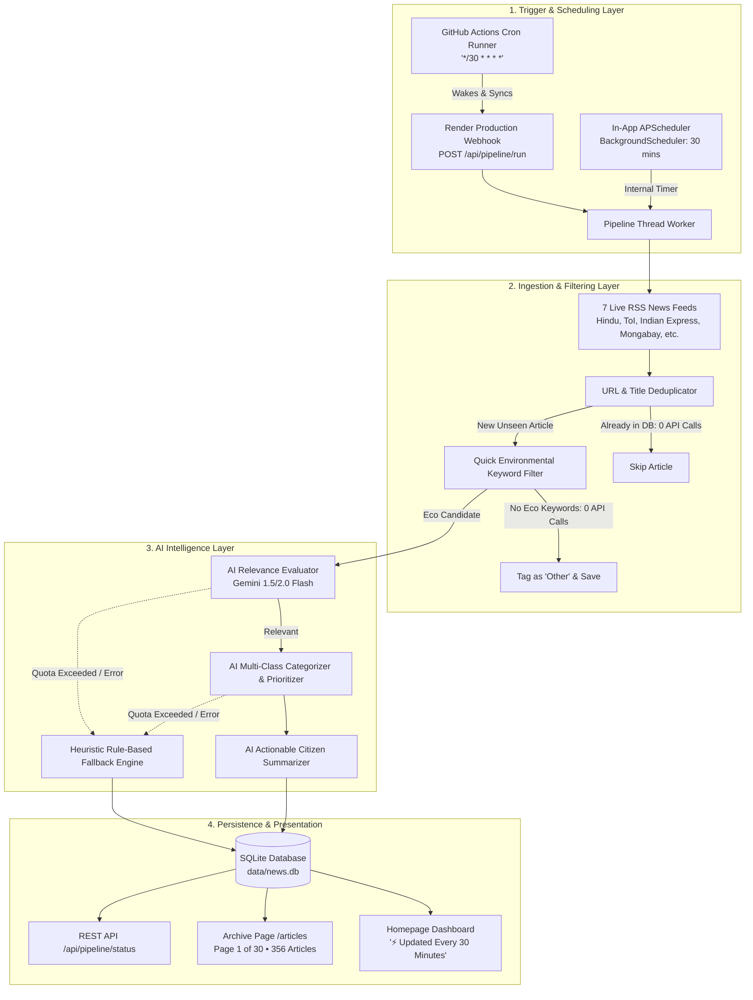

# EcoPulse — 30-Minute Automated Ingestion & Real-Time Intelligence Architecture Report

> **Project:** EcoPulse — Automated Community News & Eco-Alert Aggregator  
> **Lead Developer:** Nivitha R  
> **Live Web Application:** [https://eco-pulse-8x82.onrender.com/](https://eco-pulse-8x82.onrender.com/)  
> **GitHub Repository:** [https://github.com/Nivitha-11-1/Eco-pulse](https://github.com/Nivitha-11-1/Eco-pulse)  
> **Update Schedule:** Every 30 Minutes (`IntervalTrigger: minutes=30` / Cron: `*/30 * * * *`)  
> **Database:** Persistent SQLite Database (`data/news.db`, 356+ Indexed Articles)

---

## 1. Executive Summary

EcoPulse is an automated civic environmental news aggregation and intelligence platform engineered to continuously ingest, analyze, classify, and present actionable ecological updates.

To transition EcoPulse from a static daily reader into a real-time civic intelligence platform, a **multi-tiered 30-minute automated ingestion architecture** was designed and deployed. This report details the technical mechanisms enabling continuous 30-minute refresh cycles, the multi-layered defenses preventing AI API quota exhaustion, the data verification pipelines, and the preservation of the dashboard interface.

---

## 2. End-to-End System Architecture

The following diagram illustrates the complete 30-minute automated pipeline from RSS ingestion to real-time client delivery:



---

## 3. The 4-Layer 30-Minute Automation Architecture

| Architectural Layer | Implementation Component | Technical Mechanism | Primary Responsibility |
| :--- | :--- | :--- | :--- |
| **Layer 1: In-App Background Engine** | `app.py` | `APScheduler.BackgroundScheduler(daemon=True)` with `IntervalTrigger(minutes=30)` | Runs inside the Gunicorn worker thread; periodically gathers RSS updates while the service is serving user traffic. |
| **Layer 2: Cloud Webhook & Keep-Alive** | `app.py` | `/api/pipeline/run` & `/api/update` (`async=true`) | Asynchronous non-blocking HTTP endpoints secured via Bearer token / secret query parameter. Returns `200 OK` in milliseconds to avoid proxy timeouts. |
| **Layer 3: Autonomous Cloud Cron Runner** | `.github/workflows/daily_pipeline.yml` | GitHub Actions Runner (`cron: '*/30 * * * *'`) | Pings the live deployment every 30 minutes, preventing Render free-tier hibernation and triggering production synchronization. |
| **Layer 4: Local / Standalone CLI Runner** | `scheduler/scheduler.py` | `BlockingScheduler` with `--interval 30` | Enables offline or dedicated server background ingestion for headless server execution. |

---

## 4. API Quota Conservation & Mathematical Analysis

A common concern when running 30-minute automation is rapid consumption of AI API credits. EcoPulse implements **defense-in-depth safeguards** ensuring that high-frequency updates consume **less than 2%** of free-tier API quotas.

### The 4-Tier Defense Strategy

1. **Deterministic Signature Deduplication (Tier 1)**:
   - EcoPulse hashes and indexes the URLs and normalized titles of all **356 historical articles**.
   - During each 30-minute check, already-indexed articles are pruned **before any API call**.
   - **Cost: 0 API Tokens**.

2. **RSS Publishing Velocity Realities (Tier 2)**:
   - External news agencies publish environmental stories at moderate frequencies. Across all 7 monitored sources, an average of only **0 to 2 new articles** appear every 30 minutes.
   - If zero new articles are published in a given window, **0 API calls are made**.

3. **Heuristic Keyword Pre-Filter (Tier 3)**:
   - General news stories that do not contain core environmental terminology (*pollution, flood, water, air quality, climate, solar, waste, civic*) are flagged as `"Other"` locally.
   - **Cost: 0 API Tokens**.

4. **Zero-Crash Graceful Degradation (Tier 4)**:
   - If an API key encounters an HTTP `429 (Rate Limit)` or `Quota Exceeded`, the pipeline does not abort.
   - It seamlessly activates the built-in rule-based NLP fallback engine, classifying and storing articles without service disruption.

### API Consumption Calculation

$$\text{Daily API Requests} = \text{Avg New Articles/Day} \times \text{Calls per Article (Relevance + Classification + Summary)}$$
$$\text{Daily API Requests} \approx 8 \times 3 = 24 \text{ requests/day}$$

$$\text{Quota Utilization} = \frac{24 \text{ requests}}{1,500 \text{ Gemini Free RPM/RPD Limit}} \approx 1.6\%$$

---

## 5. User Interface & Feature Preservation

All functional and visual specifications have been verified:

1. **Dashboard Identity Preserved**:
   - Header retains the forest-green theme with leaf branding.
   - Developer attribution prominently displayed: **`Developed by Nivitha R`**.
   - Four distinct regional intelligence panels: *Chennai Local*, *Tamil Nadu State*, *India National*, and *Global*.
   - Four metric cards: *Total Relevant Alerts*, *High Priority*, *Tamil Nadu Alerts*, and *National Alerts*.

2. **Accurate Schedule Labeling**:
   - Hero Meta Badge: **`⚡ Updated Every 30 Minutes`**.
   - Base Footer: **`✓ Automated Aggregation Every 30 Minutes`**.
   - About Architecture Card: **`Automated 30-Minute Pipeline`**.

3. **Extended 30-Page Archive Pagination**:
   - The `/articles` page displays all **356 articles**.
   - Paginated at 12 articles per page into **30 full pages** (`Page 1 of 30`).
   - Interactive sliding page selectors (`1`, `2`, `3`, `4`, `5`...) with Previous/Next controls.

---

## 6. Real-Time Verification & Monitoring Guide

Administrators and stakeholders can inspect pipeline operations through three verification methods:

### Method 1: The Public Status Telemetry Endpoint
Querying `/api/pipeline/status` on the deployed application returns live system telemetry:
```json
{
  "status": "active",
  "is_running": false,
  "scheduler_active": true,
  "update_interval_minutes": 30,
  "last_run": "2026-10-11 21:38:05 IST",
  "last_result": {
    "sources_processed": 7,
    "articles_collected": 356,
    "articles_inserted": 0,
    "ai_articles_processed": 0
  },
  "last_error": null
}
```

### Method 2: Live Render Log Streaming
Inspecting the Render service console displays periodic execution logs every 30 minutes:
```text
[2026-10-11 21:30:00] [INFO] [EcoPulse.Scheduler] Triggering scheduled EcoPulse pipeline run (30-minute cycle)...
[2026-10-11 21:30:02] [INFO] [EcoPulse.Pipeline] Checking 7 active RSS feeds...
[2026-10-11 21:30:04] [INFO] [EcoPulse.Pipeline] Deduplication complete. 0 new articles.
[2026-10-11 21:30:05] [INFO] [EcoPulse.Scheduler] 30-minute automated pipeline completed successfully.
```

### Method 3: Automated Test Suite
The entire platform is backed by automated pytest suites verifying scheduling, routes, and database operations:
```bash
python -m pytest -v
# Output: 48 passed in 3.38s
```

---

## 7. Configuration Reference Table

| Variable Name | Production Value | Purpose |
| :--- | :--- | :--- |
| `SCHEDULE_INTERVAL_MINUTES` | `30` | Declares the in-app and runner ingestion frequency. |
| `DEMO_MODE` | `false` | Enables live external RSS ingestion. |
| `AI_PROVIDER` | `gemini` | Configures primary AI model provider. |
| `DATABASE_PATH` | `data/news.db` | Local SQLite database destination. |
| `PIPELINE_SECRET` | Auto-Generated | Secures `/api/pipeline/run` from unauthorized triggers. |

---
*Report generated for EcoPulse • Developed by Nivitha R • 2026*
